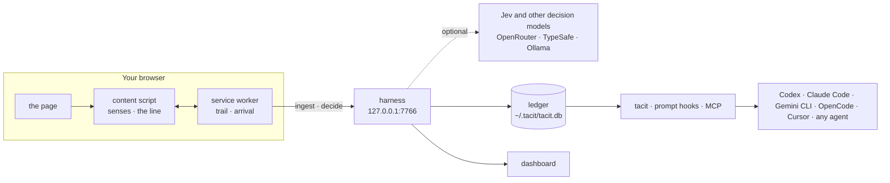

<div align="center">

<picture>
  <source media="(prefers-color-scheme: dark)" srcset="docs/assets/logo-dark.svg">
  
</picture>

# Tacit

**Your agent should already know what you're looking at.**

Tacit reads the page you're on and how you got there, keeps it on your machine,<br>
and hands it to Codex, Claude Code, Gemini CLI, Cursor or any agent. No more Cmd+A, copy, paste.

[](https://github.com/wujiajunhahah/tacit/actions/workflows/ci.yml)
[](LICENSE)
[](#for-agents)
[](#privacy-and-security)
[](https://bun.sh)

**English** · [简体中文](README.zh-CN.md) · [How to use](GUIDE.md) · [Manifesto](MANIFESTO.md) · [Design](DESIGN.md) · [Quick start](#quick-start) · [For agents](#for-agents)

<br>


</div>

<br>

> We have the smartest tool humans have ever made.
>
> And every day, we use it for the dumbest thing: Cmd+A. Copy. Paste.
>
> I'm not using AI. I'm its human clipboard.
>
> <sub>From the [manifesto](MANIFESTO.md).</sub>

Every interface today is built for one kind of user: a person with a keyboard and a mouse. The agent sitting next to you sees nothing unless you carry the page to it.

Tacit is the missing context layer. It reads the page and the path that led you there, keeps both as a ledger on your machine, predicts what you need next with fast typed decisions, and lets any agent read the context directly. Input should approach zero.

## What it does

- **Senses.** Reads the page (main text, sections, links, code blocks) and how you arrived: the search you ran, the link you clicked, the tab it came from, what you selected or copied, how long you stayed, and the passages you read closely, with your pointer too if you like. Timelines that recycle posts as you scroll, like X, are remembered whole.
- **Intent.** Infers what you are after, with the evidence behind it and a calibrated confidence. Anything you state outranks every inference.
- **Reflex.** Decides the next step: jump to the passage that answers you, copy the command you came for, open the link that matters, fold the posts that don't. Code decides offline; add an OpenRouter or TypeSafe key and [Jev](https://typesafe.ai) leads, with a second decision model behind it and a chat model for doubts. Or keep it all on your machine with a local model.
- **Surface.** One quiet line at the bottom of the page: what is next and where that came from ("from your search"). When it is sure, the next step is one key away; when it is close, it suggests; when it isn't, it asks with choices instead of a text box.
- **Handoff.** ⌥⇧C puts a compact context packet on your clipboard: intent, arrival, selection, the relevant passages, the outline. A few hundred tokens instead of the whole page.
- **Port.** Any agent reads what you are looking at, what you are trying to do, and everything you have read: a note before a prompt that needs it, the `tacit` command, or MCP tools. No copy, no paste, and no tokens spent when the screen does not matter.
- **Learning.** Undo is feedback. Tacit raises its bar where you undo, lowers it where you rarely do, and stops folding where you keep unfolding. There is nothing to tune.
- **Ledger.** Everything stays on your machine. A local dashboard is your context library: every page you read, what you read closely, how you got there, and every action Tacit took, as suggested → confirmed → executed → undone. Delete a page, or everything, and it is gone everywhere.
- **Your language.** English and 简体中文, following your browser.

| | |
|---|---|
|  |  |
|  |  |
|  |  |
|  |  |

## Quick start

**The fastest way:** paste this into Claude Code, Cursor, Codex or any coding agent, and it sets Tacit up for you, asking only for the one step that needs your hands.

```text
Set up Tacit on this computer. Read https://raw.githubusercontent.com/wujiajunhahah/tacit/main/docs/agent-setup.md and follow it step by step. Ask me only where it says so.
```

[GUIDE.md](GUIDE.md) shows what to try once it runs, and how to try it with nothing installed. By hand, you need [Bun](https://bun.sh) 1.4+ and Chrome or any Chromium browser.

```bash
git clone https://github.com/wujiajunhahah/tacit.git
cd tacit
bun install
bun run build
```

**1. Load the extension.** Open `chrome://extensions`, turn on Developer mode, click **Load unpacked** and pick the `extension` folder. (Or unzip `tacit-extension-*.zip` from [Releases](https://github.com/wujiajunhahah/tacit/releases) and load that.) The line works on its own from here.

**2. Start the harness.** It keeps the ledger, answers decisions and serves the dashboard at [127.0.0.1:7766](http://127.0.0.1:7766). `bun run service install` keeps it running from login on instead.

```bash
bun run harness
```

**3. Pair the browser.** The harness answers only clients that hold its token. This opens a local page that hands it to the extension:

```bash
bun run pair
```

**4. Connect your agents.** `bun run setup` finds Claude Code, Codex, Gemini CLI, OpenCode, Cursor and OpenClaw, and, after a yes, gives each what suits it: a hook that adds a note before a prompt that builds on your screen, a line that tells it `tacit` is there, or the MCP tools. [docs/agents.md](docs/agents.md) has every agent, by hand too. For Claude Code alone:

```bash
claude mcp add --scope user tacit -- bun "$PWD/daemon/mcp.ts"
```

Then ask your agent *"what's the main argument of the page I'm reading?"* It knows without being told. The dashboard's Connect page has the commands with the exact paths for your machine.

**5. Optional: let Jev decide.** With an [OpenRouter](https://openrouter.ai) or TypeSafe key. It asks for the key without showing it, and a running harness picks it up:

```bash
bun run keys set openrouter
bun run models --try     # who decides, and how each engine does on five questions
```

**6. Try it without the open web.** An offline demo site (a search engine, a long article, a social feed, a code repo):

```bash
bun run demo
```

Open [127.0.0.1:7777](http://127.0.0.1:7777) and search "decision latency". [127.0.0.1:7777/x/home](http://127.0.0.1:7777/x/home) is a timeline that recycles posts the way X does. No extension at hand? [127.0.0.1:7777/try](http://127.0.0.1:7777/try) runs Tacit as a page script on the demo site; `/try/off` turns it off.

### Shortcuts

| Key | Does |
|---|---|
| ⌥↵ | Run the top suggestion |
| ⌥1 ⌥2 ⌥3 | Run a specific suggestion, or pick a choice when Tacit asks (the number row, no keypad needed) |
| 1 2 3 | The same, while the slip is open |
| ⌥⇧C | Copy this page for your agent |
| ⌥⇧F | Focus on what matches |
| ⌥⇧Z | Undo the last action |
| Esc | Close the slip |

## For agents

Every agent reaches the same local ledger, three ways, cheapest first ([docs/agents.md](docs/agents.md) has each agent, [docs/using-context.md](docs/using-context.md) why):

| Way in | Costs | For |
|---|---|---|
| A prompt hook: about 100 tokens on your screen, before a prompt that builds on it, and only then | nothing until a prompt needs it | Claude Code, Codex, Gemini CLI, Cline, and OpenCode through a plugin |
| `tacit` on the command line, and one line in the agent's instructions | under 50 tokens a request | any agent with a shell |
| MCP: five read-only tools | ~100 tokens a request where tools load when needed, ~960 where they load up front | Claude Code, Cursor, OpenClaw, any MCP client |

Whether a prompt builds on the screen is decided for free when it says so ("this page", 这篇), and otherwise by Jev in about half a second, while you have been browsing in the last half hour. Unsure, slow or stale, and there is no note. `bun run agents:check` runs every agent installed here against a stand-in model to show the note arrives, and only when it should.

### The command

```bash
tacit                        # what is open now, in a few lines
tacit now --full             # this page as context: what ⌥⇧C copies
tacit search "rate limits"   # what you read before, in any language
tacit page <url>             # one page in full, with what you read closely
tacit brief --prompt "…"     # a note for a prompt, only if it needs one
tacit status                 # the harness, the ledger, who decides
```

`bun link` in the tacit folder puts `tacit` on your PATH; `bun run tacit` works without it. It reads the ledger directly and only reads it, so it works inside an agent's sandbox and with the harness stopped.

### The tools (MCP)

Five read-only tools over stdio, reading the same local ledger as the harness:

| Tool | Call it when the user says | Returns |
|---|---|---|
| `tacit_current_context` | "this page", "what I'm reading", "here" | The open page as a packet: intent, how they got here, selection, relevant passages, outline |
| `tacit_intent` | "help me with this", "what next" | The inferred goal, confidence, evidence, other readings |
| `tacit_trail` | "the article from before", "that docs page" | Recent visits, newest first, with how each was reached |
| `tacit_search` | "the post about rate limits", "我之前看的那篇" | Full-text search over pages read, English and Chinese |
| `tacit_page` | after a search or trail hit | The full readable text as markdown |

On the demo article the packet is **539 tokens; the page is 4,240.** Here is the start of one, as an agent receives it ([full example](docs/screenshots/agent-view.md)):

```markdown
# Context: tacit-labs/reflex: Calibrated reflexes for interfaces · Codeyard

**What I'm trying to do** (inferred · 91%): install reflex
- searched “install reflex” · just now

**How I got here:** searched “install reflex” → on “install reflex - Seek”
  → clicked “tacit-labs/reflex: Calibrated reflexes for interfaces”

## Most relevant on this page
### Install
bun add @tacit-labs/reflex
```

Cursor, Claude Desktop, Windsurf and other MCP clients take the same server:

```json
{
  "mcpServers": {
    "tacit": { "command": "bun", "args": ["/absolute/path/to/tacit/daemon/mcp.ts"] }
  }
}
```

### For other harnesses

Any program that holds the harness's token can follow what happens in the ledger as server-sent events: visits, pages, Tacit's actions and deletions (which never name the deleted pages). `Last-Event-ID` or `?since=` replays what it missed.

```bash
bun run events                # prints the stream, one JSON object a line
curl -N -H "Authorization: Bearer $(cat ~/.tacit/token)" http://127.0.0.1:7766/v1/events
```

## How it works



Seven layers, each a small module ([DESIGN.md](DESIGN.md) has the rules they follow):

| Layer | Where | Job |
|---|---|---|
| Senses | `extension/src/extract`, `track.ts`, `attention.ts` | Page model, arrival, selections, copies, clicks, reading |
| Ledger | `daemon/db.ts` | Visits, pages and actions in SQLite under `~/.tacit` |
| Intent | `core/intent.ts` | Evidence with time decay, candidates, calibrated confidence |
| Reflex | `core/decision.ts`, `core/cascade.ts`, `core/systemone.ts`, `core/chat.ts`, `daemon/engine.ts` | Choice, score and yes/no decisions with probabilities: code, Jev, any decision or chat model, in a hedged chain |
| Surface | `extension/src/surface` | The line, the slip, highlights, focus, folds |
| Port | `daemon/cli.ts`, `daemon/hooks.ts`, `daemon/agents.ts`, `daemon/mcp.ts`, `core/packet.ts`, `core/brief.ts` | The command, every agent's hooks, the MCP tools, the handoff packet, and when a note is worth its tokens |
| Calibrate | `core/calibrate.ts` | Thresholds and fold rules, moved by what you undo |

`core/` is plain TypeScript shared by the extension and the harness. The wire contract is [`core/protocol.ts`](core/protocol.ts).

### What Tacit asks a model

On an article, one choice question: *given what the user is trying to do, which of these is the next thing they want?* The options are the page's best actions plus "none of these". On a feed, one yes/no per post: *is this post about what the user is trying to do right now?* Answers come back with probabilities. Above 0.6 combined confidence the next step is one key away (⌥↵), above 0.35 the line suggests, and below that it asks. Calibration moves the 0.6 with your undo rate.

Who answers is a chain. With an OpenRouter key: Jev 1.14, then Inception's mercury-decide if Jev fails or is still silent at 800 ms, then code; a choice the first answer is unsure of goes to Gemini 3.1 Flash Lite once, and the surer answer stands. All of it within 3.2 s, while the local view is already on screen. On Tacit's own sample questions, Jev was right on all of them at a 488 ms median, for about $0.00002 a decision. [docs/models.md](docs/models.md) has the defaults for each key, local models, `models.json`, and the measurements.

## Principles

These come from the [manifesto](MANIFESTO.md).

- **Interfaces can differ per person; semantics cannot.** Every action has an explicit state (suggested, confirmed, executed, undone) and lands in the ledger. Nothing executes without a keystroke or a click; folding, the one thing Tacit does unasked, comes back in one click.
- **Act when sure, ask when not.** Thresholds are interface design, not model output.
- **Fold, never hide.** Every fold says why, shows a count, and comes back in one click. Personalisation should not quietly narrow what you can see or do.
- **Say where it came from.** Every prediction carries its provenance.
- **Local by default.** Nothing leaves the machine unless you add a model key, and then only decision requests. A local model keeps even those here.

The full rules, with every signal and its weight, are in [DESIGN.md](DESIGN.md).

## Privacy and security

The extension reads every page you visit, so it is built to stay out of the way and to keep what it sees to itself.

- **Page content goes to one place:** the harness on 127.0.0.1. No telemetry, no analytics, no cloud.
- **Some sites are skipped out of the box** (Gmail, Google accounts, PayPal, 1Password, Bitwarden, LastPass), and so are private areas like X messages, and any page that asks for a password: Tacit stops the moment you open them. It can be paused globally or per site from the popup.
- **Reading with the pointer is off** until you turn it on. Tacit keeps which passage and for how long, never where the pointer goes.
- **The harness binds to loopback only** and answers only clients holding its token, after it proves it holds the same token itself, so a program squatting on the port learns nothing. It rejects foreign `Host` headers (DNS rebinding), refuses requests from web-page origins, grants CORS only to the extension, and serves its UI under a nonce-based CSP.
- **The ledger is SQLite in `~/.tacit`**, readable only by you (0600 files in a 0700 folder). Delete a page or everything from the dashboard, and the extension forgets it too.
- **Models are opt-in.** With a key, each decision sends your inferred intent, its top evidence, the page's title and URL, and the candidates being judged (the labels and short snippets of the page's next steps, or up to 40 feed posts), through OpenRouter only to endpoints that keep nothing. With a prompt hook, a prompt your screen's words do not settle sends its first 400 characters, with the page's title and URL and your intent, for a yes or no. The ledger itself never leaves. Keys stay in `~/.tacit/keys.json`, never in a log or a service file. `TACIT_PRIVACY=local` asks only models on your machine.

The [privacy policy](PRIVACY.md) lists everything Tacit reads, where it goes, exactly what reaches a model, and how to delete it. Found a hole? See [SECURITY.md](SECURITY.md).

## Status

A working prototype, checked in a real browser on every push: 224 unit tests; a 45-check end-to-end run (real Chromium, the built extension, the demo site, the harness, pairing, the dashboard and an MCP client); and 20 checks of the page runtime, including an X-style virtual timeline. `bun run live` runs the extension on five real sites (Wikipedia in English and Chinese, GitHub, MDN, Hacker News), with real models when a key is set. `bun run agents:check` runs Claude Code, Codex, Gemini CLI and OpenCode, as installed, against a stand-in model.

- [x] Extension: senses, intent, the line, focus, folds, handoff
- [x] Harness: local ledger, search in English and Chinese, a dashboard that is a context library
- [x] MCP server with five tools
- [x] Any agent: the `tacit` command, prompt hooks that add a note only when a prompt needs it, setup for Claude Code, Codex, Gemini CLI, OpenCode, Cursor and OpenClaw
- [x] Decisions by Jev, any decision or chat model, or a local one, in a hedged chain with a code floor
- [x] Reading attention, X timelines, calibration from what you undo
- [x] English and 简体中文
- [x] Per-site rules, private paths, and deleting that reaches every copy
- [x] A guide, and setup by pasting one line to your agent
- [x] Search that stays fast over months of history (SQLite FTS5)
- [x] A token and pairing, an event stream for other harnesses, a background service
- [ ] Threads: months of reading as what an agent should read first
- [ ] A terminal view of its own, in the spirit of Mole or gstack
- [ ] Chrome Web Store release
- [ ] Firefox and Safari
- [ ] Desktop: the same senses through the macOS accessibility API
- [ ] Context from PDFs, videos and local files
- [ ] Interfaces that grow out of intent: a table when you compare, a diagram when you try to understand

## Development

```bash
bun run setup       # build, check, connect the agents it finds (asks first)
bun test            # unit tests: core, extension, harness
bun run typecheck   # tsc, strict
bun run e2e         # real Chromium + extension + demo site + harness + dashboard + MCP
bun run e2e:web     # the page runtime on the demo site: reading, X timelines, both languages
bun run live        # the extension on five real sites; with a key, real models too
bun run agents:check  # each agent installed here against a stand-in model: does the note arrive, and only when it should
bun run models      # who decides; --try checks each engine
bun run keys        # list, set or remove a model key
bun run service     # install, uninstall or check the background service
bun run events      # follow the ledger's event stream
bun run record      # re-record docs/tacit-demo.mp4
```

```
core/        intent, ranking, decisions, the packet, the wire protocol
extension/   Chrome MV3 extension: senses and the line (also built as dist/tacit-web.js, a page script for the demo and tests)
daemon/      harness: SQLite ledger, HTTP API, dashboard, MCP server
demo/        offline demo site: search, article, feed, repo
scripts/     build, e2e, recording, smoke test
test/        bun tests
```

Contributions are welcome. Start with [CONTRIBUTING.md](CONTRIBUTING.md).

## License

[MIT](LICENSE) © 2026 Wu JiaJun

<div align="center">
<br>
<sub>The best interaction is the least interaction.</sub>
</div>
