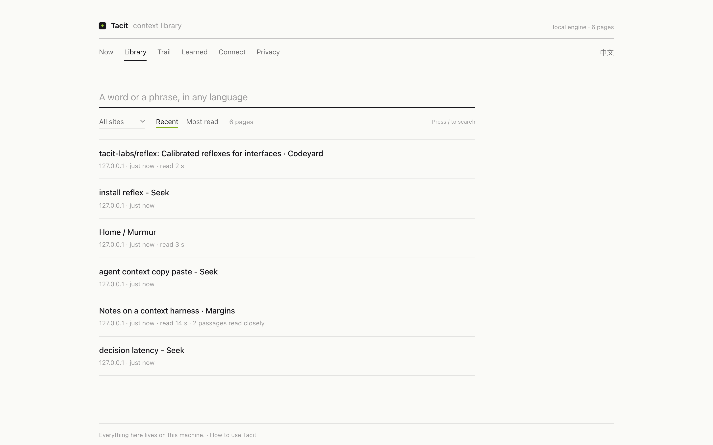
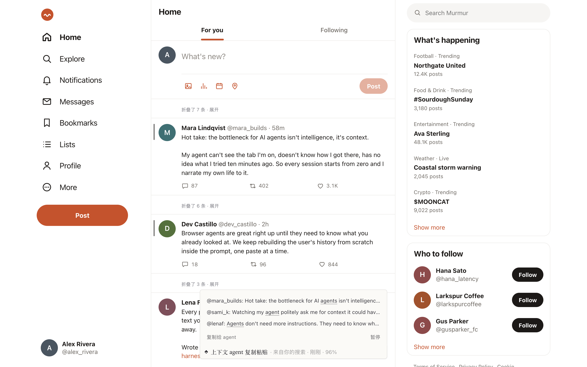
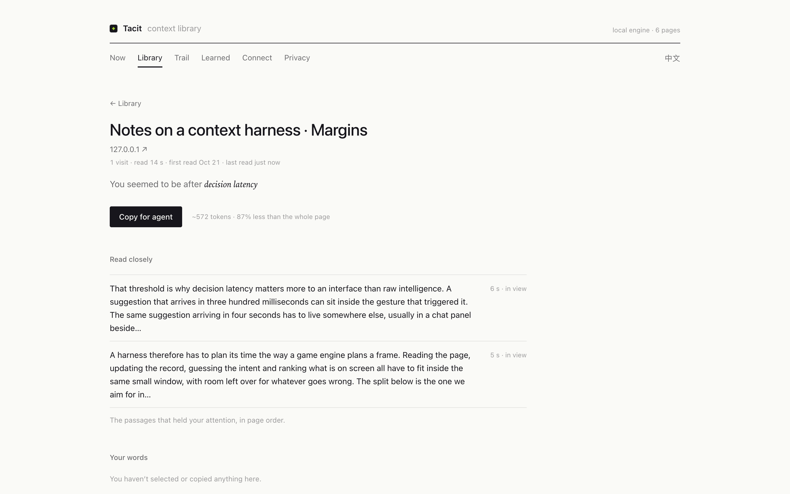
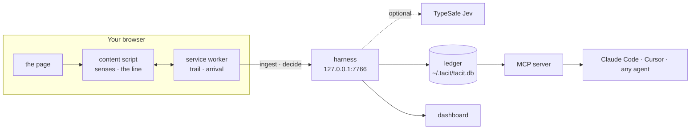

<div align="center">

<picture>
  <source media="(prefers-color-scheme: dark)" srcset="docs/assets/logo-dark.svg">
  
</picture>

# Tacit

**Your agent should already know what you're looking at.**

Tacit reads the page you're on and how you got there, keeps it on your machine,<br>
and hands it to Claude Code, Cursor or any MCP agent. No more Cmd+A, copy, paste.

[](https://github.com/wujiajunhahah/tacit/actions/workflows/ci.yml)
[](LICENSE)
[](#for-agents-mcp)
[](#privacy-and-security)
[](https://bun.sh)

**English** · [简体中文](README.zh-CN.md) · [How to use](GUIDE.md) · [Manifesto](MANIFESTO.md) · [Design](DESIGN.md) · [Quick start](#quick-start) · [For agents](#for-agents-mcp)

<br>


</div>

<br>

> We have the smartest tool humans have ever made.
>
> And every day, we use it for the dumbest thing: Cmd+A. Copy. Paste.
>
> I'm not using AI. I'm its human clipboard.
>
> <sub>From the [manifesto](MANIFESTO.md).</sub>

Every interface today is built for one kind of user: a person with a keyboard and a mouse. The agent sitting next to you sees nothing unless you carry the page to it.

Tacit is the missing context layer. It reads the page and the path that led you there, keeps both as a ledger on your machine, predicts what you need next with fast typed decisions, and lets any agent read the context directly. Input should approach zero.

## What it does

- **Senses.** Reads the page (main text, sections, links, code blocks) and how you arrived: the search you ran, the link you clicked, the tab it came from, what you selected or copied, how long you stayed, and the passages you read closely, with your pointer too if you like. Timelines that recycle posts as you scroll, like X, are remembered whole.
- **Intent.** Infers what you are after, with the evidence behind it and a calibrated confidence. Anything you state outranks every inference.
- **Reflex.** Decides the next step: jump to the passage that answers you, copy the command you came for, open the link that matters, fold the posts that don't. A local engine runs offline; [TypeSafe's Jev](https://typesafe.ai) takes over when you add a key.
- **Surface.** One quiet line at the bottom of the page: what is next and where that came from ("from your search"). When it is sure, the next step is one key away; when it is close, it suggests; when it isn't, it asks with choices instead of a text box.
- **Handoff.** ⌥⇧C puts a compact context packet on your clipboard: intent, arrival, selection, the relevant passages, the outline. A few hundred tokens instead of the whole page.
- **Port.** An MCP server, so your agent reads what you are looking at, what you are trying to do, and everything you have read. No copy, no paste.
- **Learning.** Undo is feedback. Tacit raises its bar where you undo, lowers it where you rarely do, and stops folding where you keep unfolding. There is nothing to tune.
- **Ledger.** Everything stays on your machine. A local dashboard is your context library: every page you read, what you read closely, how you got there, and every action Tacit took, as suggested → confirmed → executed → undone. Delete a page, or everything, and it is gone everywhere.
- **Your language.** English and 简体中文, following your browser.

| | |
|---|---|
|  |  |
|  |  |
|  |  |
|  |  |

## Quick start

**The fastest way:** paste this into Claude Code, Cursor, Codex or any coding agent, and it sets Tacit up for you, asking only for the one step that needs your hands.

```text
Set up Tacit on this computer. Read https://raw.githubusercontent.com/wujiajunhahah/tacit/main/docs/agent-setup.md and follow it step by step. Ask me only where it says so.
```

[GUIDE.md](GUIDE.md) shows what to try once it runs, and how to try it with nothing installed. By hand, you need [Bun](https://bun.sh) 1.4+ and Chrome or any Chromium browser.

```bash
git clone https://github.com/wujiajunhahah/tacit.git
cd tacit
bun install
bun run build
```

**1. Load the extension.** Open `chrome://extensions`, turn on Developer mode, click **Load unpacked** and pick the `extension` folder. (Or unzip `tacit-extension-*.zip` from [Releases](https://github.com/wujiajunhahah/tacit/releases) and load that.) The line works on its own from here.

**2. Start the harness.** It keeps the ledger, answers decisions and serves the dashboard at [127.0.0.1:7766](http://127.0.0.1:7766).

```bash
bun run harness
```

**3. Connect your agent.** `bun run setup` does this for Claude Code, and installs a skill that tells it when to use Tacit. Or by hand, from the repo folder:

```bash
claude mcp add --scope user tacit -- bun "$PWD/daemon/mcp.ts"
```

Then ask Claude Code *"what's the main argument of the page I'm reading?"* It calls `tacit_current_context` by itself. The dashboard's Connect page has this command with the exact paths for your machine.

**4. Try it without the open web.** An offline demo site (a search engine, a long article, a social feed, a code repo):

```bash
bun run demo
```

Open [127.0.0.1:7777](http://127.0.0.1:7777) and search "decision latency". [127.0.0.1:7777/x/home](http://127.0.0.1:7777/x/home) is a timeline that recycles posts the way X does. No extension at hand? [127.0.0.1:7777/try](http://127.0.0.1:7777/try) runs Tacit as a page script on the demo site; `/try/off` turns it off.

### Keys

| Key | Does |
|---|---|
| ⌥↵ | Run the top suggestion |
| ⌥1 ⌥2 ⌥3 | Run a specific suggestion, or pick a choice when Tacit asks |
| ⌥⇧C | Copy this page for your agent |
| ⌥⇧F | Focus on what matches |
| ⌥⇧Z | Undo the last action |
| Esc | Close the slip |

## For agents (MCP)

Five read-only tools over stdio, reading the same local ledger as the harness:

| Tool | Call it when the user says | Returns |
|---|---|---|
| `tacit_current_context` | "this page", "what I'm reading", "here" | The open page as a packet: intent, how they got here, selection, relevant passages, outline |
| `tacit_intent` | "help me with this", "what next" | The inferred goal, confidence, evidence, other readings |
| `tacit_trail` | "the article from before", "that docs page" | Recent visits, newest first, with how each was reached |
| `tacit_search` | "the post about rate limits", "我之前看的那篇" | Full-text search over pages read, English and Chinese |
| `tacit_page` | after a search or trail hit | The full readable text as markdown |

On the demo article the packet is **539 tokens; the page is 4,240.** Here is the start of one, as an agent receives it ([full example](docs/screenshots/agent-view.md)):

```markdown
# Context: tacit-labs/reflex: Calibrated reflexes for interfaces · Codeyard

**What I'm trying to do** (inferred · 91%): install reflex
- searched “install reflex” · just now

**How I got here:** searched “install reflex” → on “install reflex - Seek”
  → clicked “tacit-labs/reflex: Calibrated reflexes for interfaces”

## Most relevant on this page
### Install
bun add @tacit-labs/reflex
```

Cursor, Claude Desktop, Windsurf and other MCP clients take the same server:

```json
{
  "mcpServers": {
    "tacit": { "command": "bun", "args": ["/absolute/path/to/tacit/daemon/mcp.ts"] }
  }
}
```

## How it works



Seven layers, each a small module ([DESIGN.md](DESIGN.md) has the rules they follow):

| Layer | Where | Job |
|---|---|---|
| Senses | `extension/src/extract`, `track.ts`, `attention.ts` | Page model, arrival, selections, copies, clicks, reading |
| Ledger | `daemon/db.ts` | Visits, pages and actions in SQLite under `~/.tacit` |
| Intent | `core/intent.ts` | Evidence with time decay, candidates, calibrated confidence |
| Reflex | `core/decision.ts`, `core/jev.ts` | Choice, score and yes/no decisions with probabilities, local or Jev |
| Surface | `extension/src/surface` | The line, the slip, highlights, focus, folds |
| Port | `daemon/mcp.ts`, `core/packet.ts` | MCP tools and the handoff packet |
| Calibrate | `core/calibrate.ts` | Thresholds and fold rules, moved by what you undo |

`core/` is plain TypeScript shared by the extension and the harness. The wire contract is [`core/protocol.ts`](core/protocol.ts).

### What Tacit asks Jev

On an article, one choice question: *given what the user is trying to do, which of these is the next thing they want?* The options are the page's best actions plus "none of these". On a feed, one yes/no per post: *is this post about what the user is trying to do right now?* Answers come back with probabilities. Above 0.6 combined confidence the next step is one key away (⌥↵), above 0.35 the line suggests, and below that it asks. Calibration moves the 0.6 with your undo rate.

```bash
TYPESAFE_API_KEY=... bun run harness
```

Any error, or no answer within 2.5 s, falls back to the local engine.

## Principles

These come from the [manifesto](MANIFESTO.md).

- **Interfaces can differ per person; semantics cannot.** Every action has an explicit state (suggested, confirmed, executed, undone) and lands in the ledger. Nothing executes without a keystroke or a click; folding, the one thing Tacit does unasked, comes back in one click.
- **Act when sure, ask when not.** Thresholds are interface design, not model output.
- **Fold, never hide.** Every fold says why, shows a count, and comes back in one click. Personalisation should not quietly narrow what you can see or do.
- **Say where it came from.** Every prediction carries its provenance.
- **Local by default.** Nothing leaves the machine unless you turn on Jev, and then only decision requests.

The full rules, with every signal and its weight, are in [DESIGN.md](DESIGN.md).

## Privacy and security

The extension reads every page you visit, so it is built to stay out of the way and to keep what it sees to itself.

- **Page content goes to one place:** the harness on 127.0.0.1. No telemetry, no analytics, no cloud.
- **Some sites are skipped out of the box** (Gmail, Google accounts, PayPal, 1Password, Bitwarden, LastPass), and so are private areas like X messages: Tacit stops the moment you open them. It can be paused globally or per site from the popup.
- **Reading with the pointer is off** until you turn it on. Tacit keeps which passage and for how long, never where the pointer goes.
- **The harness binds to loopback only**, rejects foreign `Host` headers (DNS rebinding), refuses requests from web-page origins, grants CORS only to the extension, and serves its UI under a nonce-based CSP.
- **The ledger is SQLite in `~/.tacit`**, readable only by you (0600 files in a 0700 folder). Delete a page or everything from the dashboard, and the extension forgets it too.
- **Jev is opt-in.** With a TypeSafe key, each decision sends your inferred intent, its top evidence, the page's title and URL, and the candidates being judged (the labels and short snippets of the page's next steps, or up to 40 feed posts). The ledger itself never leaves.

The [privacy policy](PRIVACY.md) lists everything Tacit reads, where it goes, exactly what reaches Jev, and how to delete it. Found a hole? See [SECURITY.md](SECURITY.md).

## Status

A working prototype, checked in a real browser on every push: 140 unit tests; a 41-check end-to-end run (real Chromium, the built extension, the demo site, the harness, the dashboard and an MCP client); and 20 checks of the page runtime, including an X-style virtual timeline.

- [x] Extension: senses, intent, the line, focus, folds, handoff
- [x] Harness: local ledger, search in English and Chinese, a dashboard that is a context library
- [x] MCP server with five tools
- [x] Jev decisions with a local fallback
- [x] Reading attention, X timelines, calibration from what you undo
- [x] English and 简体中文
- [x] Per-site rules, private paths, and deleting that reaches every copy
- [x] A guide, and setup by pasting one line to your agent
- [ ] Chrome Web Store release
- [ ] Firefox and Safari
- [ ] Search that stays fast over months of history
- [ ] Desktop: the same senses through the macOS accessibility API
- [ ] Context from PDFs, videos and local files
- [ ] Interfaces that grow out of intent: a table when you compare, a diagram when you try to understand

## Development

```bash
bun run setup       # build, check, connect Claude Code (asks first)
bun test            # unit tests: core, extension, harness
bun run typecheck   # tsc, strict
bun run e2e         # real Chromium + extension + demo site + harness + dashboard + MCP
bun run e2e:web     # the page runtime on the demo site: reading, X timelines, both languages
bun run record      # re-record docs/tacit-demo.mp4
```

```
core/        intent, ranking, decisions, the packet, the wire protocol
extension/   Chrome MV3 extension: senses and the line (also built as dist/tacit-web.js, a page script for the demo and tests)
daemon/      harness: SQLite ledger, HTTP API, dashboard, MCP server
demo/        offline demo site: search, article, feed, repo
scripts/     build, e2e, recording, smoke test
test/        bun tests
```

Contributions are welcome. Start with [CONTRIBUTING.md](CONTRIBUTING.md).

## License

[MIT](LICENSE) © 2026 Wu JiaJun

<div align="center">
<br>
<sub>The best interaction is the least interaction.</sub>
</div>
