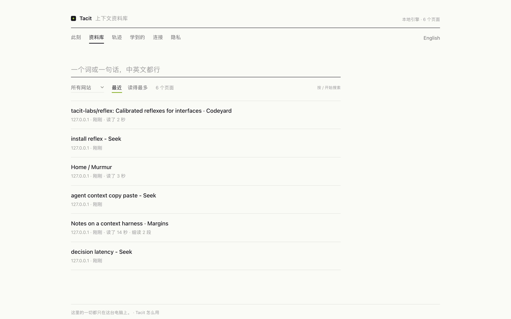
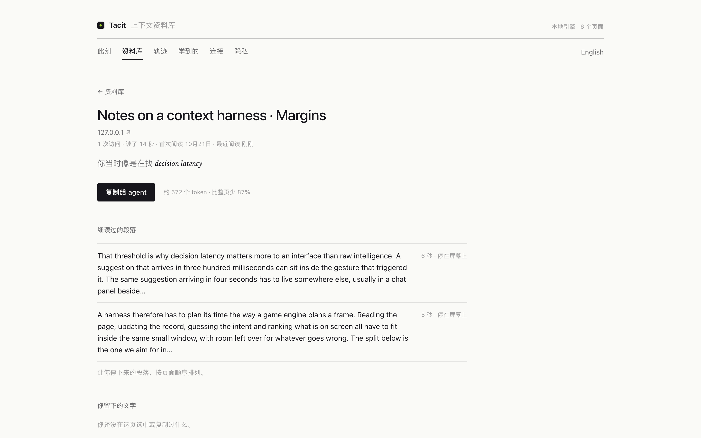

<div align="center">

<picture>
  <source media="(prefers-color-scheme: dark)" srcset="docs/assets/logo-dark.svg">
  
</picture>

# Tacit

**你的 agent，本该知道你正在看什么。**

Tacit 读取你正在看的页面，以及你是怎么一路来到这里的，把它们留在你自己的电脑上，<br>
再交给 Claude Code、Cursor 或任何 MCP agent。不用再 Cmd+A、复制、粘贴。

[](https://github.com/wujiajunhahah/tacit/actions/workflows/ci.yml)
[](LICENSE)
[](#给-agent-用mcp)
[](#隐私与安全)
[](https://bun.sh)

[English](README.md) · **简体中文** · [使用指南](GUIDE.zh-CN.md) · [宣言](MANIFESTO.zh-CN.md) · [设计](DESIGN.zh-CN.md) · [快速开始](#快速开始) · [给 agent 用](#给-agent-用mcp)

<br>


</div>

<br>

> 我们手里握着人类历史上最聪明的工具。
>
> 然后每天对它做最笨的事：Cmd+A。复制。粘贴。
>
> 我不是在用 AI。我是在给 AI 当搬运工。
>
> <sub>摘自[宣言](MANIFESTO.zh-CN.md)。</sub>

今天所有的界面，都只为一种使用者设计：拿着键盘和鼠标的人。坐在你旁边的 agent 什么也看不见，除非你把页面搬给它。

Tacit 补上的是缺失的 context 这一层。它读页面，也读把你带到这里的那条路径，把两者作为一本 ledger 留在本地；用快速的类型化判断预测你下一步要什么；再让任何 agent 直接读取这些 context。input 应该趋近于零。

## 它能做什么

- **感知。** 读页面（正文、章节、链接、代码块），也读你是怎么来的：搜了什么、点了哪个链接、从哪个标签页打开、选中和复制了什么、停留了多久，以及你细读了哪几段；愿意的话，指针停留也算。像 X 这样边滚动边回收帖子的时间线，也能完整记住。
- **意图。** 推断你想要什么，附上证据和校准过的置信度。你亲口说出的意图，永远优先于任何推断。
- **反射。** 决定下一步：跳到回答你问题的那一段、复制你要找的命令、打开真正相关的链接、折叠无关的帖子。本地引擎离线可用；加上 key 后由 [TypeSafe 的 Jev](https://typesafe.ai) 接手。
- **界面。** 页面底部安静的一行字：下一步是什么，以及这个判断从哪来（"来自你的搜索"）。有把握时，下一步只差一个按键；接近时给建议；没把握时用选项来问你，而不是让你打字。
- **交接。** ⌥⇧C 把一个精简的上下文包放进剪贴板：意图、来路、选中内容、相关段落、页面大纲。几百个 token，而不是整页。
- **接口。** 一个 MCP server，让你的 agent 直接读到你正在看什么、想做什么，以及你读过的一切。不用复制，不用粘贴。
- **学习。** 撤销就是反馈。你撤销得多的地方，Tacit 更谨慎；很少撤销的地方，它更果断；你总是展开的网站，它就不再折叠。没有任何东西需要你调。
- **账本。** 一切都留在你的电脑上。本地 dashboard 就是你的上下文资料库：读过的每一页、细读过的段落、怎么来的，以及 Tacit 做过的每一个动作：建议 → 确认 → 执行 → 撤销。删掉一页或全部，所有地方都会忘掉。
- **你的语言。** 英文和简体中文，跟随浏览器。

| | |
|---|---|
|  |  |
|  |  |
|  |  |
|  |  |

## 快速开始

**最快的方式：** 把下面这段话粘贴给 Claude Code、Cursor、Codex 或任何编程 agent，它会帮你装好 Tacit，只在需要你亲手做的那一步叫你。

```text
Set up Tacit on this computer. Read https://raw.githubusercontent.com/wujiajunhahah/tacit/main/docs/agent-setup.md and follow it step by step. Ask me only where it says so.
```

装好之后能玩什么，以及怎么不装任何东西先试一下，见[使用指南](GUIDE.zh-CN.md)。自己动手装的话，需要 [Bun](https://bun.sh) 1.4+，以及 Chrome 或任何 Chromium 内核的浏览器。

```bash
git clone https://github.com/wujiajunhahah/tacit.git
cd tacit
bun install
bun run build
```

**1. 加载扩展。** 打开 `chrome://extensions`，开启开发者模式，点"加载已解压的扩展程序"，选择 `extension` 文件夹。（也可以从 [Releases](https://github.com/wujiajunhahah/tacit/releases) 下载 `tacit-extension-*.zip`，解压后加载。）到这一步，页面底部那一行就已经能用了。

**2. 启动 harness。** 它负责保存账本、回答判断请求，并在 [127.0.0.1:7766](http://127.0.0.1:7766) 提供 dashboard。

```bash
bun run harness
```

**3. 接上你的 agent。** `bun run setup` 会替 Claude Code 完成这一步，并装上一个 skill，告诉它什么时候该用 Tacit。也可以自己在仓库目录下运行：

```bash
claude mcp add --scope user tacit -- bun "$PWD/daemon/mcp.ts"
```

然后问 Claude Code：*"我正在看的这页，核心观点是什么？"* 它会自己调用 `tacit_current_context`。dashboard 的"连接"页给出这条命令，路径是你这台电脑上的绝对路径。

**4. 先在离线 demo 里试。** 一个离线 demo 站点（搜索引擎、长文章、社交信息流、代码仓库）：

```bash
bun run demo
```

打开 [127.0.0.1:7777](http://127.0.0.1:7777)，搜索 "decision latency"。[127.0.0.1:7777/x/home](http://127.0.0.1:7777/x/home) 是一条像 X 一样回收帖子的时间线。手边没装扩展？打开 [127.0.0.1:7777/try](http://127.0.0.1:7777/try)，Tacit 会以网页脚本的形式在 demo 站点上运行；`/try/off` 关闭。

### 快捷键

| 按键 | 作用 |
|---|---|
| ⌥↵ | 执行第一条建议 |
| ⌥1 ⌥2 ⌥3 | 执行指定的建议；Tacit 询问时，选对应的选项 |
| ⌥⇧C | 把这页复制给你的 agent |
| ⌥⇧F | 只看相关内容 |
| ⌥⇧Z | 撤销上一步 |
| Esc | 收起面板 |

## 给 agent 用（MCP）

五个只读工具，通过 stdio 提供，和 harness 读的是同一本本地账本：

| 工具 | 用户这样说时调用 | 返回 |
|---|---|---|
| `tacit_current_context` | "这页"、"我正在看的"、"这里" | 当前页面的 context 包：意图、来路、选中内容、相关段落、大纲 |
| `tacit_intent` | "帮我弄一下这个"、"下一步做什么" | 推断出的目标、置信度、证据、其他可能 |
| `tacit_trail` | "之前那篇文章"、"刚才那个文档页" | 最近的访问记录，新的在前，附带每次是怎么到达的 |
| `tacit_search` | "讲限流的那篇"、"我之前看的那篇" | 对读过的页面做全文搜索，中英文都可以 |
| `tacit_page` | 搜索或轨迹找到之后 | 页面的完整正文，markdown 格式 |

在 demo 文章上，context 包是 **539 个 token，整页是 4,240 个。** 下面是 agent 收到的一个 context 包的开头（[完整示例](docs/screenshots/agent-view.md)）：

```markdown
# Context: tacit-labs/reflex: Calibrated reflexes for interfaces · Codeyard

**What I'm trying to do** (inferred · 91%): install reflex
- searched “install reflex” · just now

**How I got here:** searched “install reflex” → on “install reflex - Seek”
  → clicked “tacit-labs/reflex: Calibrated reflexes for interfaces”

## Most relevant on this page
### Install
bun add @tacit-labs/reflex
```

Cursor、Claude Desktop、Windsurf 等 MCP 客户端，用同一个 server：

```json
{
  "mcpServers": {
    "tacit": { "command": "bun", "args": ["/absolute/path/to/tacit/daemon/mcp.ts"] }
  }
}
```

## 工作原理


七层，每层都是一个小模块（它们遵守的规则见 [DESIGN.zh-CN.md](DESIGN.zh-CN.md)）：

| 层 | 位置 | 职责 |
|---|---|---|
| 感知 | `extension/src/extract`、`track.ts`、`attention.ts` | 页面模型、来路、选中、复制、点击、阅读 |
| 账本 | `daemon/db.ts` | 访问、页面和动作，存在 `~/.tacit` 下的 SQLite 里 |
| 意图 | `core/intent.ts` | 带时间衰减的证据、候选意图、校准过的置信度 |
| 反射 | `core/decision.ts`、`core/jev.ts` | 选择题、打分题、是非题，附概率；本地或 Jev |
| 界面 | `extension/src/surface` | 那一行字、展开面板、高亮、专注、折叠 |
| 接口 | `daemon/mcp.ts`、`core/packet.ts` | MCP 工具和交接用的 context 包 |
| 校准 | `core/calibrate.ts` | 阈值和折叠规则，随你的撤销而移动 |

`core/` 是扩展和 harness 共用的纯 TypeScript。通信协议在 [`core/protocol.ts`](core/protocol.ts)。

### Tacit 问 Jev 什么

在文章页，只问一道选择题：*根据用户想做的事，下面哪一个是他下一步想要的？* 选项是页面上最好的几个动作，外加"都不是"。在信息流里，每个帖子问一道是非题：*这个帖子和用户此刻想做的事有关吗？* 答案带着概率回来。综合置信度高于 0.6 时，下一步只差一个按键（⌥↵）；高于 0.35 时给建议；再低就问你。校准会按你的撤销率移动 0.6 这条线。

```bash
TYPESAFE_API_KEY=... bun run harness
```

任何错误，或 2.5 秒内没有回答，都会退回本地引擎。

## 原则

这些原则来自[宣言](MANIFESTO.zh-CN.md)。

- **界面可以千人千面，语义不能。** 每个动作都有明确的状态（建议、确认、执行、撤销），并写进账本。没有一次按键或点击，什么都不会执行；唯一不经你同意就做的是折叠，点一下就能恢复。
- **有把握就做，没把握就问。** 阈值是界面设计，不是模型输出。
- **折叠，而不隐藏。** 每次折叠都说明原因、显示数量，一次点击就能恢复。个性化不该悄悄缩小你能看到、能做到的范围。
- **说清楚判断从哪来。** 每个预测都带着它的出处。
- **默认本地。** 除非你打开 Jev，否则什么都不会离开你的电脑；打开后，也只有判断请求会发出去。

完整的规则，包括每个信号和它的权重，见 [DESIGN.zh-CN.md](DESIGN.zh-CN.md)。

## 隐私与安全

扩展会读你访问的每一个页面，所以它被设计成尽量不打扰你，也不外传它看到的东西。

- **页面内容只去一个地方：** 127.0.0.1 上的 harness。没有遥测，没有统计，没有云端。
- **默认跳过一些网站**（Gmail、Google 账户、PayPal、1Password、Bitwarden、LastPass），也跳过 X 私信这样的私密区域：一打开，Tacit 就停下。也可以在弹出面板里全局暂停，或只在当前网站暂停。
- **指针跟读默认关闭。** 打开后，Tacit 只记哪一段、停了多久，从不记录指针去了哪里。
- **harness 只监听本机回环地址**，拒绝不认识的 `Host` 头（防 DNS rebinding），拒绝来自网页的请求，只对扩展开放 CORS，账本页面使用基于 nonce 的 CSP。
- **账本是 `~/.tacit` 里的 SQLite**，只有你自己可读（文件 0600，目录 0700）。在 dashboard 里删掉一页或全部，扩展也会一起忘掉。
- **Jev 需要你主动开启。** 加上 TypeSafe key 后，每次判断会发送：推断出的意图、最主要的证据、页面标题和 URL，以及正在被判断的候选项（页面上可能的下一步的文字和简短片段，或最多 40 条信息流帖子）。账本本身永远不会离开你的电脑。

[隐私政策](PRIVACY.md)（英文）列出了 Tacit 读取的全部内容、它们的去向、发给 Jev 的确切字段，以及如何删除。发现漏洞？请看 [SECURITY.md](SECURITY.md)。

## 进展

一个能用的原型，每次推送都在真实浏览器里验证：140 个单元测试；41 项端到端检查（真实 Chromium、构建好的扩展、demo 站点、harness、dashboard 和一个 MCP 客户端）；以及 20 项网页运行时检查，包括一个仿 X 的虚拟时间线。

- [x] 扩展：感知、意图、那一行字、专注、折叠、交接
- [x] harness：本地账本、中英文搜索、作为上下文资料库的 dashboard
- [x] 五个工具的 MCP server
- [x] Jev 判断，带本地兜底
- [x] 阅读注意力、X 时间线、按撤销校准
- [x] 英文和简体中文
- [x] 使用指南，以及把一句话粘贴给 agent 就能装好
- [ ] 上架 Chrome Web Store
- [ ] Firefox 和 Safari
- [ ] 几个月的浏览历史也能快速搜索
- [ ] 桌面：通过 macOS 辅助功能 API 做同样的感知
- [ ] 来自 PDF、视频和本地文件的 context
- [ ] 跟着意图长出来的界面：想比较时是一张表，想理解时是一张图

## 开发

```bash
bun run setup       # 构建、检查、接上 Claude Code（会先问你）
bun test            # 单元测试：core、扩展、harness
bun run typecheck   # tsc，严格模式
bun run e2e         # 真实 Chromium + 扩展 + demo 站点 + harness + dashboard + MCP
bun run e2e:web     # demo 站点上的网页运行时：阅读、X 时间线、中英文
bun run record      # 重新录制 docs/tacit-demo.mp4
```

```
core/        意图、排序、判断、context 包、通信协议
extension/   Chrome MV3 扩展：感知和那一行字（也构建成 dist/tacit-web.js，供 demo 和测试使用的网页脚本）
daemon/      harness：SQLite 账本、HTTP API、dashboard、MCP server
demo/        离线 demo 站点：搜索、文章、信息流、代码仓库
scripts/     构建、端到端测试、录屏、冒烟测试
test/        bun 测试
```

欢迎贡献，从 [CONTRIBUTING.md](CONTRIBUTING.md) 开始。

## 许可证

[MIT](LICENSE) © 2026 Wu JiaJun

<div align="center">
<br>
<sub>最好的交互，是最少的交互。</sub>
</div>
